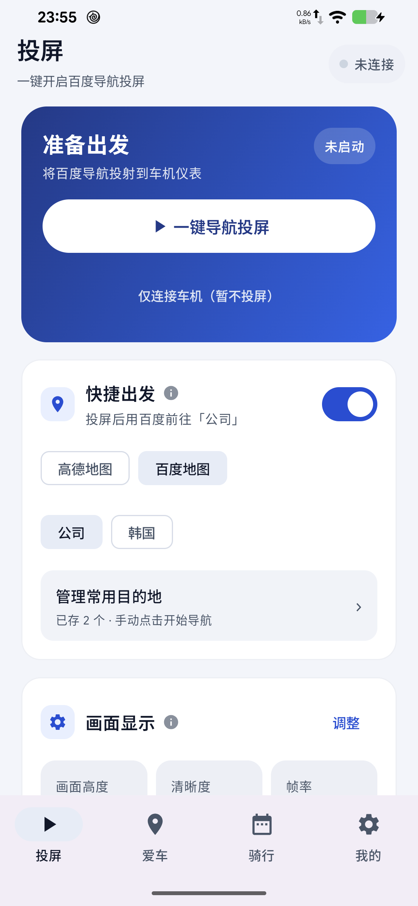
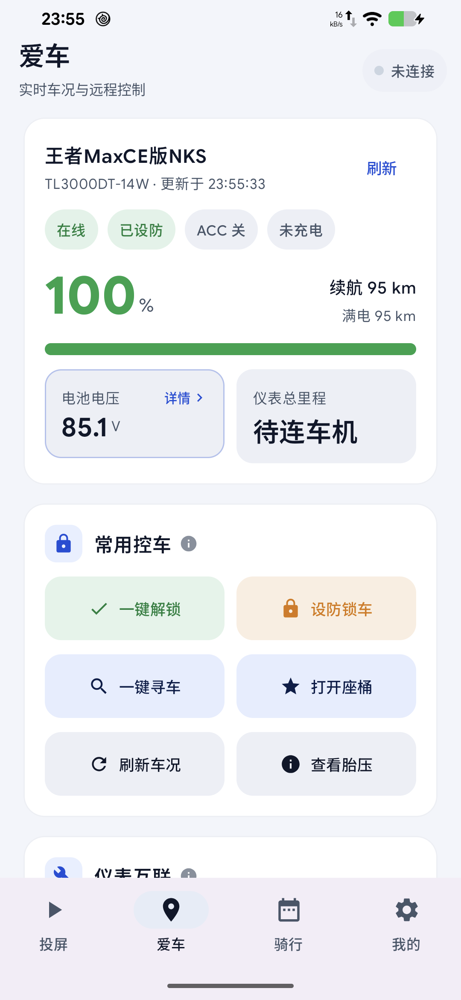
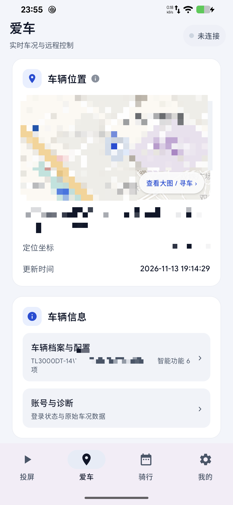
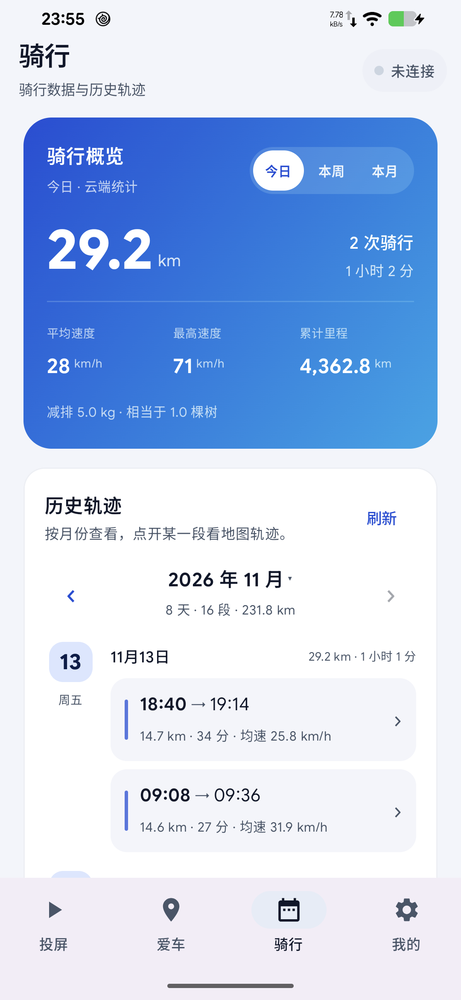

# 王者骑行助手（tailg-cast）

> **免责声明**：本项目为个人开源的第三方骑行与 TFT 仪表投屏辅助工具，与台铃科技（TAILG）、高德地图、百度地图等任何厂商均无隶属、合作或官方授权关系。项目仅供个人学习与技术研究交流，严禁用于商业用途或任何违法违规行为；骑行途中请严格遵守交通法规，切勿操作手机或分心观看屏幕，使用本软件产生的一切风险由使用者自行承担。

面向支持无线投屏 / BLE 互联的电动车 TFT 仪表开发板与车机的 Android 客户端，基于 **Kotlin + Jetpack Compose + Material 3** 构建。

## 主要功能

- **虚拟屏独立投屏**：支持 Root / Shizuku 创建独立虚拟屏并启动导航应用，无需系统录屏授权弹窗，支持分辨率黑边预设、码率/帧率调节与手机端触摸预览。
- **双地图与自动导航**：支持 **高德地图** 与 **百度地图** 自由切换，支持常用目的地收藏、地图选点、投屏后自动拉起骑行路线，并支持通过 Shizuku / Root 一键开启无障碍服务自动点击「开始导航」。
- **爱车状态与寻车地图**：查看实时电量、续航、电压与电池详情，支持远程控车、胎压查询、仪表主题/壁纸上传，以及车位地图展示、经纬度中文逆地理编码和步行寻车跳转。
- **骑行统计与轨迹回放**：按日 / 周 / 月查看里程、时长与均速，支持月度历史行程列表与单次轨迹地图回放。

## 界面预览

| 投屏主页 | 爱车车况 | 车辆定位（已脱敏） | 骑行统计 |
| :---: | :---: | :---: | :---: |
|  |  |  |  |

## 模块结构

| 模块 | 说明 |
|---|---|
| `:protocol` | 纯 Kotlin/JVM 协议编解码与主题包解析（含单元测试） |
| `:engine` | 虚拟屏管理、H.264 编码推流、车机 Wi-Fi/BLE 通信与后端服务 |
| `:app` | Compose UI、高德/百度导航调起、无障碍服务、云端接口与本地地图 |

## 本地构建

```bash
# 运行单元测试并构建 Debug APK
./gradlew :protocol:test :app:testDebugUnitTest :app:assembleDebug

# 安装到已连接的手机
adb install -r app/build/outputs/apk/debug/app-debug.apk
```

构建环境要求：**JDK 17**、**Android SDK 36**（首次运行由 Gradle Wrapper 自动配置）。

## CI 与自动发版

仓库配置了 GitHub Actions 工作流（[.github/workflows/ci-release.yml](.github/workflows/ci-release.yml)）：

- 每次 `push` / `pull_request` 自动执行 `:protocol:test :app:testDebugUnitTest :app:assembleDebug` 并归档 Debug APK。
- 推送 `v*` 格式标签（例如 `git tag v0.1.0 && git push origin v0.1.0`）时，自动从标签提取 `versionName`（如 `0.1.0`）并计算 `versionCode`（`MAJOR*10000 + MINOR*100 + PATCH`），使用仓库 Secrets 中的签名证书构建并校验已签名的 Release APK，自动发布到 GitHub Releases。
